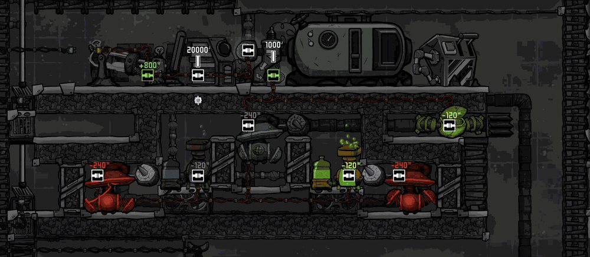

# Power Draw Overlay

An Oxygen Not Included mod. It colors the power overlay (F2) by load and by draw, so you can see where your electricity goes.

- Wires change color with how full their circuit is, from blue at a light load through green and yellow to red at the limit.
- Buildings that use power are tinted by how much they draw right now, relative to the biggest consumer on screen. Idle and switched-off buildings are gray. The wattage number above each building uses the same color.
- Hovering a wire lists the biggest consumers on that circuit with their current and rated wattage. Buildings of the same type are added together.

The mod only changes how the overlay looks. It doesn't change any power values, so you can add or remove it on an existing save.

## Build

You need the .NET SDK and a copy of the game. If the game isn't at the path set in `PowerDrawOverlay.csproj`, pass `GameDir`:

    dotnet build -c Release -o out -p:GameDir="C:\path\to\OxygenNotIncluded\"

Copy `out\PowerDrawOverlay.dll`, `mod.yaml`, `mod_info.yaml` and `preview.png` into a folder called `PowerDrawOverlay` inside `Documents\Klei\OxygenNotIncluded\mods\Local`, then enable it on the Mods screen.

## License

MIT. See `LICENSE`.
